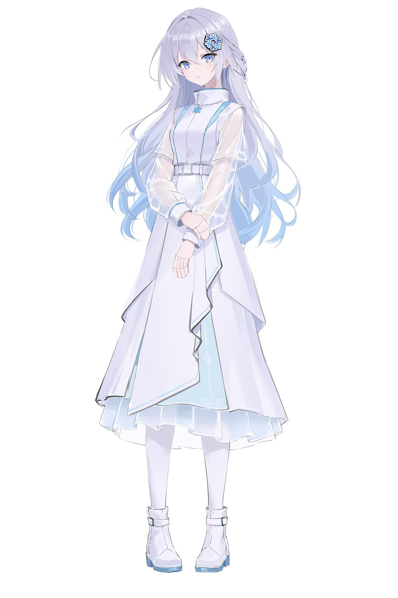

# Rikka (六花)

The mascot of Project Rikka

## About

Project Rikka is a desktop environment we're building, with its own Wayland compositor and shell.

| | |
|---|---|
| Name | 六花 (Rikka) |
| Gender | Female |
| Motif | Snowflake |
| Original design | [XC—星尘/叶子](https://www.mihuashi.com/profiles/1091006) |

## Her name

六花 (rikka) is an old, poetic Japanese word for snow. The characters mean "six" and "flower", after the six-pointed shape of snow crystals. The idea goes back a long way: the Chinese text *Hanshi Waizhuan* already mentions that snowflakes have six points (雪花独六出).

The [NixOS](https://nixos.org) logo is also a snowflake, made of six lambdas (λ). We liked how the two lined up, and that's where her name comes from. It's also why she wears a snowflake hair clip.

## Guidelines

You're welcome to make fan works of Rikka, as long as you follow these rules:

- Non-commercial use only. No selling and no merchandise, including at doujin events.
- No AI training or AI image generation, including img2img and LoRA.
- No R-18 content, and nothing that would hurt the character's image.
- No political or religious use.
- No discrimination, harassment, or defamation.
- If you publish anything featuring Rikka, official or fan-made, credit the original designer, XC—星尘/叶子.

We may update these rules. The version in this repository is the current one. If you have questions, please [open an issue](https://github.com/project-rikka/rikka-chan/issues).

## About AI

We use AI on Project Rikka, and we used it for this README too.

For us, AI is a tool for getting work done faster. I use it when I write code, but the ideas are mine. I don't think it should be used in ways that take away from people's own creativity.

AI image generation usually goes further than that. It produces the finished picture, which is the creative part, and many musicians and illustrators don't accept it. Out of respect for Rikka's designer and other artists, we don't allow her to be used for AI training or image generation.

---

Character © Project Rikka · Original design by [XC—星尘/叶子](https://www.mihuashi.com/profiles/1091006)

